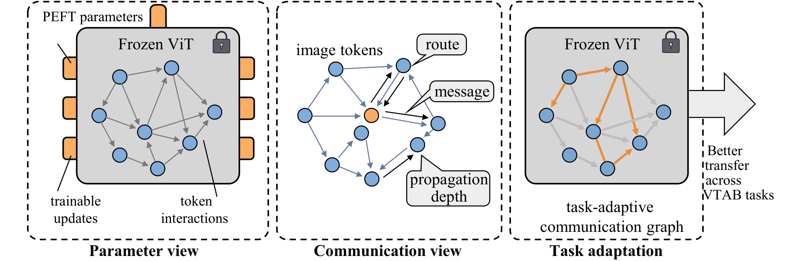
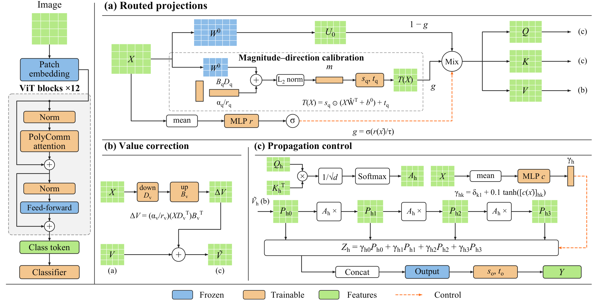
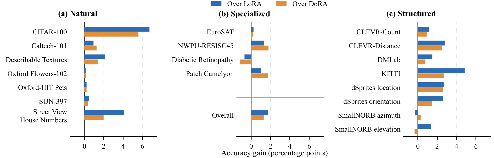
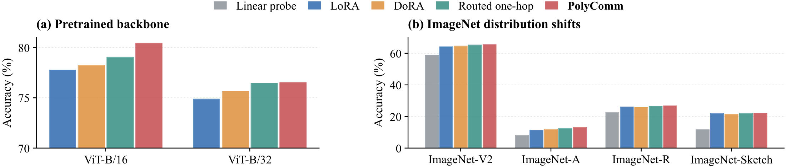
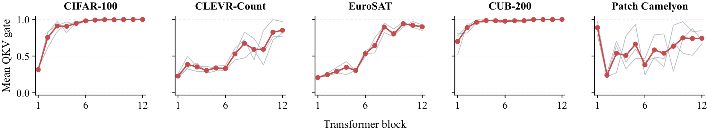
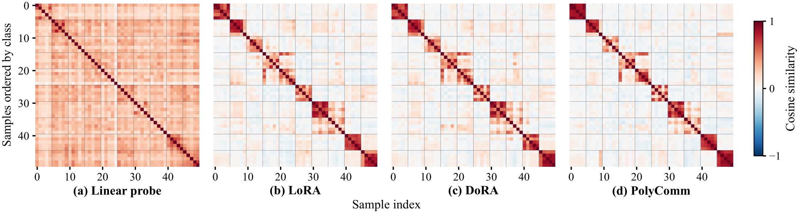
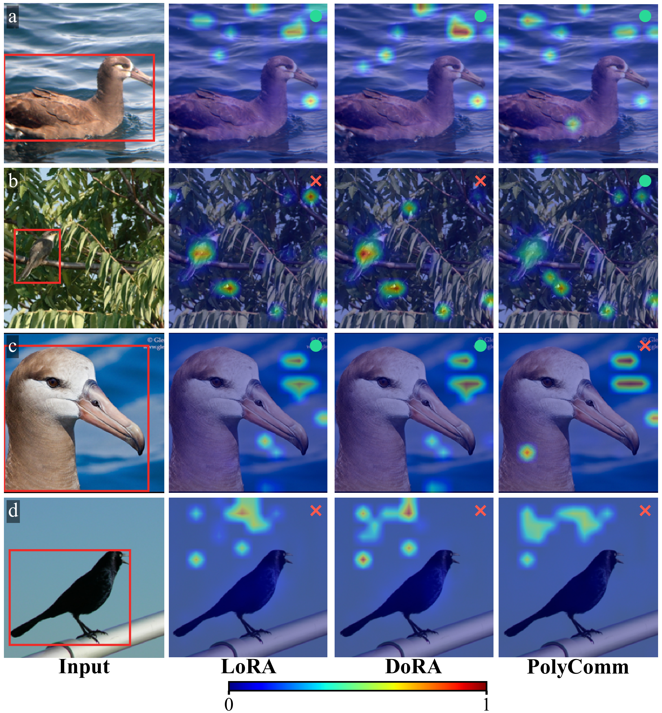
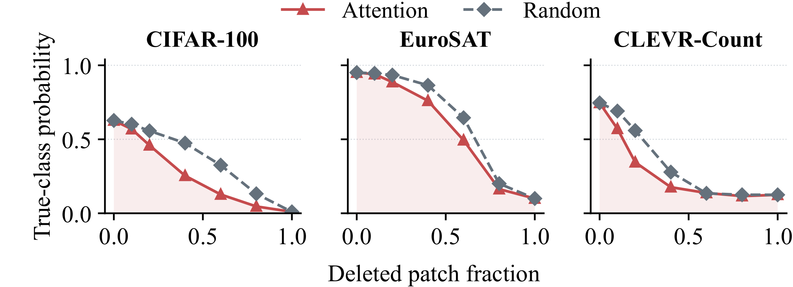
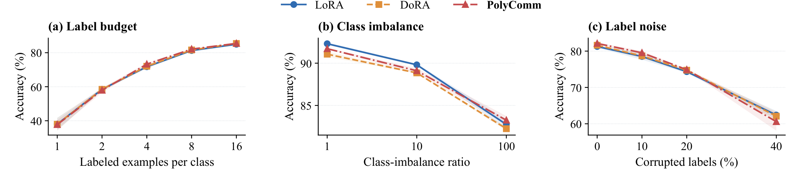

<a name="top"></a>

<div align="center">

<h1>PolyComm</h1>
<h3>Image-Conditioned Polynomial Attention<br>for Parameter-Efficient Visual Adaptation</h3>

<p>
Zixi Wang · Yubo Huang · Xin Lai · Pengyue Cheng ·<br>
Jingzehua Xu · Xiongyu Hu · Chuan He
</p>

<p>
<code>Vision Transformers</code> &nbsp; <code>Parameter-Efficient Adaptation</code> &nbsp; <code>PyTorch</code>
</p>

<p>
<a href="#overview">Overview</a> ·
<a href="#method">Method</a> ·
<a href="#results">Results</a> ·
<a href="#quick-start">Quick Start</a> ·
<a href="#configuration">Configuration</a> ·
<a href="#citation">Citation</a>
</p>

</div>

**PolyComm adapts how image tokens exchange information: their routes, their value features, and their propagation through attention.** It combines image-conditioned QKV routing, an independent value residual, and headwise polynomial propagation in a pretrained vision transformer.

| VTAB-19 macro accuracy | Improvement over LoRA / DoRA | Backbone adaptation parameters |
| :---: | :---: | :---: |
| **68.38 ± 0.49%** | **+1.74 / +1.27 percentage points** | **0.966M** |

*Reported in the accompanying manuscript using ImageNet-21k pretrained ViT-B/16. Accuracy is averaged over three independent runs; adaptation counts exclude the classifier. The headline comparison uses rank-8 LoRA and DoRA. A separate comparison at similar parameter budgets appears below.*

<p align="center">
  <a href="assets/figures/motivation.png"></a>
</p>

*Figure 1 from the manuscript. A communication view connects compact trainable updates to token interaction and task adaptation. Click any figure to view the full-resolution image.*

## Overview

Parameter-efficient adaptation gives each task a small trainable state while reusing a pretrained model. PolyComm allocates this state across three complementary parts of the attention computation:

| Control | What it changes | How PolyComm implements it |
| :--- | :--- | :--- |
| **Token routes** | The affinities used to exchange information | An image-conditioned gate interpolates frozen and calibrated low-rank QKV projections. |
| **Value content** | The features carried through attention | A separate low-rank value branch adds a correction directly from the block input. |
| **Propagation** | How repeatedly aggregated features contribute to the output | Image-conditioned, headwise coefficients combine orders zero through three of the same attention operator. |

The pretrained projection and feed-forward weights are retained. Training updates the enabled adapter parameters, affine calibration at selected normalization outputs, and a task-specific classifier. At inference, the gate and coefficient networks respond to each image through a forward pass.

**Release contents.** This repository provides model construction, PolyComm and baseline implementations, configuration files, adapter checkpoint utilities, and the paper figures used in this README. Dataset preparation, full training and evaluation runners, pretrained weights, and trained task checkpoints are not included. The examples below show how to integrate the released model components into an experiment.

## Method

<p align="center">
  <a href="assets/figures/method.png"></a>
</p>

*Figure 2 from the manuscript. The three controls share the normalized block input and have separate trainable parameters. Each head reuses its own attention operator across propagation orders.*

### 1. Route between frozen and calibrated projections

Let $X$ be the normalized block-input tokens and $\bar{x}$ their mean, including the class token. A small router predicts one gate per image and transformer block:

$$
g(X)=\sigma\!\left(r(\bar{x})/\tau\right),\qquad
U(X)=U_0(X)+g(X)\bigl(T(X)-U_0(X)\bigr).
$$

$U_0$ is the frozen packed QKV projection. $T$ applies a DoRA-style low-rank direction update, learned magnitudes, and channelwise scale and shift. The gate is shared across tokens and QKV channels within a block. Splitting $U$ supplies the queries, keys, and base values.

### 2. Refine value features independently

A second low-rank branch refines the values after the routed QKV projection:

$$
\widetilde V=V+\frac{\alpha_v}{r_v}(XD_v^\top)B_v^\top.
$$

This branch can adapt message content even when the QKV gate favors the frozen projection.

### 3. Combine propagation orders within each head

For head $h$, define $A_h=\mathrm{softmax}(Q_hK_h^\top/\sqrt d)$. PolyComm applies the same operator recurrently:

$$
P_{h0}=\widetilde V_h,\qquad
P_{hk}=A_hP_{h,k-1},\qquad
Z_h=\sum_{k=0}^{K}\gamma_{hk}(X)P_{hk}.
$$

The readout coefficients are bounded corrections around ordinary one-hop attention:

$$
\gamma_{hk}(X)=\delta_{k1}+\eta\tanh\!\left([c(\bar{x})]_{hk}\right),
\qquad K=3,\quad\eta=0.1.
$$

Order zero retains a token's value features, order one performs standard attention aggregation, and higher orders compose the same token interactions. Coefficients are image-conditioned and headwise; they can be signed and need not sum to one. The recurrence avoids explicitly constructing matrix powers. Heads are then concatenated, projected, and calibrated within the existing transformer block.

At initialization, the coefficient vector is $(0,1,0,0)$ and the value residual is zero. The initial calibrated QKV projection is close to the pretrained projection, accounting for the finite numerical stabilizer used by its magnitude normalization.

## Results

All numbers in this section are **results reported in the manuscript**. They are not measurements produced by the quick-start example.

### VTAB-19: one PolyComm configuration across all tasks

The benchmark contains seven natural, four specialized, and eight structured tasks. Each task uses 800 training images and 200 validation images; the held-out test set is evaluated after checkpoint selection. Results below are mean ± sample standard deviation over three independent runs. **All 19** gives every task equal weight.

| Method | Adapter params (M) | Natural (%) | Specialized (%) | Structured (%) | All 19 (%) |
| :--- | ---: | ---: | ---: | ---: | ---: |
| Linear probe | 0.000 | 65.20 ± 0.08 | 77.36 ± 0.16 | 23.93 ± 0.15 | 50.38 ± 0.05 |
| LoRA, rank 8 | 0.295 | 76.35 ± 0.17 | 83.14 ± 0.37 | 49.90 ± 1.10 | 66.64 ± 0.53 |
| DoRA, rank 8 | 0.323 | 76.90 ± 0.30 | 82.97 ± 0.55 | 50.61 ± 0.79 | 67.11 ± 0.47 |
| Calibrated one-hop | 0.508 | 77.58 ± 0.18 | 83.35 ± 0.33 | 51.14 ± 0.59 | 67.66 ± 0.35 |
| Routed one-hop | 0.730 | 77.48 ± 0.40 | 83.42 ± 0.52 | 51.26 ± 0.34 | 67.69 ± 0.27 |
| **PolyComm** | **0.966** | **78.45 ± 0.24** | **83.60 ± 0.31** | **51.96 ± 0.95** | **68.38 ± 0.49** |

*Selected methods from manuscript Table I and Supplementary Table S1. Counts exclude the task classifier. The primary comparison uses the stated method configurations and has different adapter parameter counts.*

PolyComm improves the macro mean by **1.74 percentage points over LoRA** and **1.27 over DoRA**, exceeding each on **17 of 19 tasks**. It has the highest overall mean among the configurations evaluated in the manuscript.

<p align="center">
  <a href="assets/figures/transfer_gains.png"></a>
</p>

*Figure 3 from the manuscript. Per-task gains in percentage points; Overall is the equal-weight average across all 19 tasks.*

### Comparable adapter budgets on three representative tasks

To examine how adaptation capacity is allocated, the manuscript separately increases the ranks of LoRA and DoRA to give all three methods approximately 0.95–0.97M adapter parameters.

| Method | QKV rank | Adapter params (M) | CIFAR-100 (%) | EuroSAT (%) | CLEVR-Count (%) | Three-task macro (%) |
| :--- | ---: | ---: | ---: | ---: | ---: | ---: |
| LoRA | 26 | 0.958 | 59.06 ± 0.40 | 94.14 ± 0.66 | 75.20 ± 0.62 | 76.13 ± 0.16 |
| DoRA | 25 | 0.949 | 60.96 ± 1.02 | **95.15 ± 0.14** | 76.05 ± 1.38 | 77.38 ± 0.61 |
| **PolyComm** | **8** | **0.966** | **67.73 ± 0.56** | 94.86 ± 0.28 | **78.74 ± 1.11** | **80.44 ± 0.39** |

*Manuscript Table II. These results concern three tasks, separately from the full VTAB-19 macro above. PolyComm also uses its independent rank-4 value branch and other attention controls.*

The macro gains at these comparable budgets are **+4.31 points over LoRA** and **+3.06 over DoRA**. DoRA has the highest EuroSAT mean in this comparison.

### Transfer across backbones and distribution shifts

The cross-backbone experiment reports **76.52 ± 0.38%** for PolyComm on ViT-B/32 in the three-task comparison. In a separate experiment, ImageNet adaptation with 16 source examples per class gives a **31.86 ± 0.27%** macro mean across ImageNet-V2, ImageNet-A, ImageNet-R, and ImageNet-Sketch, compared with **30.93%** for both LoRA and DoRA. All four targets use the complete 1,000-class classifier, with checkpoint selection based on source data.

<p align="center">
  <a href="assets/figures/generalization.png"></a>
</p>

*Figure 4 from the manuscript. Panel (a) shows the three-task backbone comparison; panel (b) shows the four ImageNet shifts. PolyComm has the highest mean on three shifts, while the routed one-hop control has the highest ImageNet-Sketch mean.*

### What the learned operator does

Routing profiles vary across tasks and depth. Measurements of weighted propagation terms identify a dominant first-order pathway, with learned zeroth- and higher-order corrections. The following diagnostics connect this behavior to representations and prediction sensitivity.

<details>
<summary><strong>Explore routing and feature organization</strong></summary>

<p align="center">
  <a href="assets/figures/routing.png"></a>
</p>

*Figure 6. Learned QKV routing across transformer blocks. Thin gray curves show independently trained models; red curves show their mean.*

<p align="center">
  <a href="assets/figures/feature_relations.png"></a>
</p>

*Figure 7. Pairwise cosine similarities for the same 50 CIFAR-100 images, ordered by class, with five images from each of ten classes. Thin lines mark class boundaries; all matrices use the same range from −1 to 1.*

</details>

<details>
<summary><strong>Explore attention maps and patch deletion</strong></summary>

<p align="center">
  <a href="assets/figures/attention.png"></a>
</p>

*Figure 8. Final-block class-token-to-patch attention, averaged over heads, on common CUB-200 inputs. Red boxes mark annotated birds; circles and crosses denote correct and incorrect predictions. The three maps for each input share a linear scale normalized by their joint maximum. These examples deliberately include both successes and failures.*

<p align="center">
  <a href="assets/figures/deletion.png"></a>
</p>

*Figure 9. Prediction sensitivity to removing image patches. Patches are set to zero after image normalization. Attention-ranked deletion and random deletion are compared using the probability of the true class.*

These maps visualize spatial attention. The deletion experiment measures how predictions respond to removing image information; it is a separate diagnostic from object-localization accuracy.

</details>

<details>
<summary><strong>Explore limited labels, imbalance, and label noise</strong></summary>

<p align="center">
  <a href="assets/figures/data_regimes.png"></a>
</p>

*Figure 5. Independent CIFAR-100 experiments using the official training pool and a separate clean validation set. These are distinct from the VTAB training split. Shaded bands indicate standard deviation; all evaluated conditions, including conditions without a PolyComm advantage, are retained.*

</details>

## Quick Start

### 1. Install the model dependencies

Use **Python 3.10 or newer** and a compatible PyTorch/torchvision build for your CPU or CUDA environment. From the repository root, run:

```bash
python -m pip install -r requirements.txt
```

The root requirements declare PyTorch ≥2.6.0, torchvision ≥0.21.0, timm ≥1.0.0, NumPy ≥1.24.0, and PyYAML ≥6.0. These are dependency lower bounds, not an exact environment lockfile. Keep the repository root on the Python import path so that `model_utils` and `src` can be imported.

### 2. Provide pretrained backbone weights

Place the ImageNet-21k pretrained ViT-B/16 checkpoint in Google-style `.npz` format at:

```text
checkpoints/pretrained/ViT-B_16_in21k.npz
```

Create the directories if needed. Alternatively, use an absolute path to your local checkpoint in the example below. Pretrained weights are loaded **before** the adaptation modules are inserted.

### 3. Build the manuscript model

> **Configuration:** use [`configs/polycomm_tmm.yaml`](configs/polycomm_tmm.yaml). It enables learned polynomial coefficients with `coeff_trainable: true`. The method's internal defaults and several legacy configurations use frozen coefficients, so they are not interchangeable with the full manuscript model.

Run this example from the repository root after supplying the checkpoint:

```python
from pathlib import Path

import torch
import yaml

from model_utils import build_model

device = torch.device("cuda" if torch.cuda.is_available() else "cpu")
weights = Path("checkpoints/pretrained/ViT-B_16_in21k.npz").resolve()
if not weights.is_file():
    raise FileNotFoundError(f"Provide the pretrained checkpoint at: {weights}")

with open("configs/polycomm_tmm.yaml", encoding="utf-8") as stream:
    method_config = yaml.safe_load(stream)["method"]

backbone, classifier = build_model(
    {
        "backbone": "vit_base_patch16_224",
        "weights": str(weights),
        "method": method_config,
    },
    classes=100,
    device=device,
)

adapter_params = sum(p.numel() for p in backbone.parameters() if p.requires_grad)
head_params = sum(p.numel() for p in classifier.parameters())
print(f"Backbone adaptation parameters: {adapter_params:,}")
print(f"Classifier parameters: {head_params:,}")

# Shape check only: synthetic input and an untrained task classifier.
backbone.eval()
classifier.eval()
with torch.inference_mode():
    images = torch.zeros(1, 3, 224, 224, device=device)
    logits = classifier(backbone(images))
print("Logits shape:", tuple(logits.shape))  # (1, 100)
```

For the manuscript ViT-B/16 configuration, the expected adaptation count is **966,060**, with another **76,900** parameters for a 100-class linear classifier. `build_model` returns the backbone and classifier separately. Real classification requires task training or a compatible trained adapter and classifier checkpoint.

For ViT-B/32, set `backbone` to `vit_base_patch32_224` and provide the matching `.npz` checkpoint.

### 4. Connect to your training loop

Use the trainable backbone parameters together with the returned classifier:

```python
trainable = [p for p in backbone.parameters() if p.requires_grad]
trainable += list(classifier.parameters())
optimizer = torch.optim.AdamW(trainable, lr=1e-3, weight_decay=0.05)

backbone.train()
classifier.train()
# In your own loop, with normalized images and integer class labels:
# logits = classifier(backbone(images))
# loss = torch.nn.functional.cross_entropy(logits, labels)
# optimizer.zero_grad(set_to_none=True)
# loss.backward()
# optimizer.step()
```

This is an integration example. A benchmark runner must also implement the data splits, preprocessing, precision mode, learning-rate schedule, validation, and checkpoint selection described in [Reproduction Notes](#reproduction-notes).

### 5. Save and restore the adaptation state

```python
from model_utils import adapter_state, restore_adapter

# Save after task training.
torch.save(
    {
        "adapter": adapter_state(backbone),
        "head": classifier.state_dict(),
        "method": method_config,
        "backbone": "vit_base_patch16_224",
        "classes": 100,
    },
    "polycomm_task.pt",
)

# Rebuild the same pretrained backbone, method configuration, and classifier
# before restoring in a new process.
state = torch.load("polycomm_task.pt", map_location="cpu", weights_only=True)
restore_adapter(backbone, classifier, state)
backbone.eval()
classifier.eval()
```

`adapter_state` saves the backbone parameters currently marked trainable; it does not duplicate the frozen pretrained backbone. `restore_adapter` checks that the adapter parameter names match the reconstructed configuration and loads the classifier state separately. Retain the same pretrained weights and class-label ordering when restoring a task model.

<details>
<summary><strong>Advanced: inject PolyComm into an already loaded compatible ViT</strong></summary>

The following uses `method_config` from the YAML-loading example above and assumes that `backbone` is a fresh, compatible timm ViT whose pretrained weights have already been loaded.

```python
import types

from src.methods import create_method
from src.methods.novel.polyattn import PolyAttnWrapper
from model_utils import fast_poly_forward

backbone.requires_grad_(False)
adapter = create_method(method_config["name"], method_config)
backbone = adapter.inject(backbone)

trainable_ids = {id(p) for p in adapter.get_trainable_params()}
for parameter in backbone.parameters():
    parameter.requires_grad_(id(parameter) in trainable_ids)

# Match the optimized execution path used by build_model.
for module in backbone.modules():
    if isinstance(module, PolyAttnWrapper):
        module._campaign_original_forward = module.forward
        module.forward = types.MethodType(fast_poly_forward, module)

# Move the adapted backbone and your task head to the same device afterward.
```

The explicit attention implementation is in `polyattn.py`. `fast_poly_forward` uses PyTorch scaled dot-product attention for the same recurrence when attention dropout is zero; otherwise it preserves the original execution path. The documented manuscript backbones are global-attention ViT-B/16 and ViT-B/32.

</details>

## Configuration

The complete settings are in [`configs/polycomm_tmm.yaml`](configs/polycomm_tmm.yaml). The main controls map to the paper as follows:

| Role | Configuration key | Manuscript setting |
| :--- | :--- | :--- |
| Method registration | `name` | `polycomm` |
| Maximum propagation order | `max_hops` | `3` |
| Input-dependent coefficients | `mode`, `headwise` | `dynamic`, `true` |
| Learn polynomial coefficients | `coeff_trainable` | `true` |
| Bounded one-hop corrections | `parameterization`, `coeff_activation`, `delta_scale` | `delta`, `tanh`, `0.1` |
| Coefficient MLP width ratio | `mlp_ratio` | `0.03125` → width 24 for ViT-B |
| Packed QKV adaptation | `dora_qkv_rank`, `dora_qkv_alpha` | `8`, `16` |
| QKV channel calibration | `dora_qkv_ssf` | `true` |
| Image-conditioned gate | `dora_qkv_gate_mode`, `dora_qkv_gate_scope` | `dynamic`, `calibrated` |
| Gate initialization / temperature | `dora_qkv_gate_init`, `dora_qkv_gate_temperature` | `0.2`, `1.0` |
| Router MLP width ratio | `dora_qkv_gate_mlp_ratio` | `0.03125` → width 24 for ViT-B |
| Independent value update | `value_adapter_rank`, `value_adapter_alpha` | `4`, `8` |
| Output and normalization calibration | `ssf_target_modules`, `inject_norm` | `[proj, norm]`, `true` |

The manuscript configuration adapts all twelve ViT-B attention blocks. Coefficient, QKV-adapter, and value-adapter dropout are zero. The configured higher-order coefficient norm cap is `0.25`; with degree three and residual scale `0.1`, the tanh bounds already keep the higher-order norm below that cap.

## Code Map

| File or directory | Purpose |
| :--- | :--- |
| [`configs/polycomm_tmm.yaml`](configs/polycomm_tmm.yaml) | Full manuscript configuration and recommended starting point. |
| [`model_utils.py`](model_utils.py) | Pretrained ViT loading, model construction, SDPA recurrence, and adapter save/restore utilities. |
| [`src/methods/novel/polycomm.py`](src/methods/novel/polycomm.py) | PolyComm composition and trainable-parameter selection. |
| [`src/methods/novel/polyattn.py`](src/methods/novel/polyattn.py) | QKV routing, DoRA projection, independent value branch, coefficient generator, and propagation. |
| [`src/methods/novel/polyssf.py`](src/methods/novel/polyssf.py) | Composition of polynomial attention and scale/shift calibration. |
| [`src/methods/baselines/`](src/methods/baselines/) | Comparison-method implementations, including LoRA, DoRA, SSF, adapters, and prompting. |
| [`src/methods/registry.py`](src/methods/registry.py) | Method registration and construction. |
| [`src/configs/methods/`](src/configs/methods/) | Retained method variants and legacy configurations. |
| [`src/backbones/`](src/backbones/) | Additional backbone-building components. |
| [`src/task_heads/`](src/task_heads/) | Task-head components; the manuscript helper returns its own separate linear classifier. |
| [`assets/figures/`](assets/figures/) | PNG renders of the original manuscript figures used in this README. |
| [`requirements.txt`](requirements.txt) | Dependencies for the released model components. |

The retained backbone and task-head components are implementation resources; the manuscript evaluations and examples here focus on ViT-B image classification.

## Reproduction Notes

The supplied model release can be connected to a training pipeline with the following manuscript protocol. Full experiment runners and datasets must be supplied separately.

<details>
<summary><strong>VTAB-19 training and evaluation protocol</strong></summary>

| Setting | Manuscript protocol |
| :--- | :--- |
| Pretrained model | ImageNet-21k pretrained ViT-B/16 |
| Adaptation data | Fixed 800-image training split and 200-image validation split per task |
| Input preprocessing | Resize shorter side to 224; center crop to 224 × 224; shared ImageNet normalization |
| Training | 100 epochs; batch size 64; BF16 arithmetic |
| Optimizer | AdamW; weight decay 0.05 |
| Learning rate | Warm up from `1e-6` for 10 epochs to a peak of `1e-3`; cosine decay toward `1e-5` |
| Checkpoint selection | Maximum validation accuracy; validation cross entropy breaks ties |
| Test reporting | Held-out test set after checkpoint selection; three independent runs |
| Aggregation | Average task accuracies within each run, then report mean and sample standard deviation |

The limited-label CIFAR-100 extensions use the official training pool and a separate clean 2,000-image validation set. The ImageNet distribution-shift experiment uses 16 source examples per class. These protocols are separate from VTAB-19.

</details>

<details>
<summary><strong>Parameter accounting and execution cost</strong></summary>

The ViT-B/16 configuration has **966,060 trainable backbone adaptation parameters**. An affine classifier adds $769L$ parameters for $L$ classes, giving **1,042,960** total trainable parameters for CIFAR-100.

The manuscript reports the following PolyComm costs on CIFAR-100:

| Measurement | Reported value |
| :--- | ---: |
| Trainable parameters, including classifier | 1.043M |
| Training update, batch size 64 | 117.74 ms |
| Single-image inference | 15.29 ms |
| Peak allocated training memory | 9.03 GiB |

*Source: manuscript Table IV and the supplementary measurement protocol. Measurements use BF16 on an RTX PRO 6000 Blackwell Max-Q GPU, with 20 warm-up iterations and 60 timed repetitions. Training timing includes forward, backward, gradient clipping, and the optimizer update; data loading and checkpoint I/O are excluded.*

These values characterize the reported hardware and implementation. Polynomial recurrence and dynamic routing add execution work; the compact task-specific parameter state does not imply lower latency or peak memory than LoRA or DoRA.

</details>

## Citation

If you use PolyComm in your research, please cite the accompanying manuscript. The entry below records the manuscript metadata; replace it with the final publisher citation when available.

```bibtex
@misc{wang2026polycomm,
  title  = {{PolyComm}: Image-Conditioned Polynomial Attention for
            Parameter-Efficient Visual Adaptation},
  author = {Wang, Zixi and Huang, Yubo and Lai, Xin and Cheng, Pengyue
            and Xu, Jingzehua and Hu, Xiongyu and He, Chuan},
  year   = {2026},
  note   = {Manuscript}
}
```

## Acknowledgements

PolyComm builds on ideas from [LoRA](https://github.com/microsoft/LoRA), [DoRA](https://github.com/NVlabs/DoRA), and [SSF](https://github.com/dongzelian/SSF), and uses [timm](https://github.com/huggingface/pytorch-image-models) for vision transformer backbones.

All figures shown here are rendered from the original figures accompanying the manuscript, with their panel content preserved.

<p align="center"><a href="#top">Back to top ↑</a></p>
